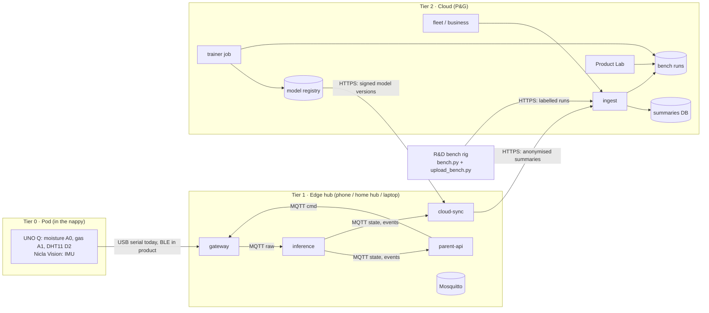

# PodCare architecture: edge, cloud and deployment

## Decision in one paragraph
**Everything needed to look after the baby runs at the edge**: sensing on the pod; inference, alerts and the parent app on the hub (phone or home hub; a laptop at the hackathon). Raw sensor streams **never leave the home**. The **cloud only receives opt-in, anonymised one-minute summaries** for P&G fleet insight. It also receives **bench data from R&D labs**, which contains no personal data, and it trains and publishes models that hubs download. This gives low-latency alerts that keep working offline, privacy by design, low bandwidth and battery use, and a clean split between consumer value (edge) and P&G value (cloud).

## Tiers

## What runs where, and why
| Function | Where | Why there |
|---|---|---|
| Sampling at 50 Hz, averaging to 1 Hz | Pod MCU | Cuts radio traffic about 50×; saves battery |
| Still/moving classification (depth-2 tree) | Pod MCU (portable) / hub | Small enough for an MCU; can gate the radio (send less while asleep) |
| Calibration, features, dry/wet/soiled, "full within 1 h" | **Hub: inference** | Alerts within seconds, **must work without internet**; raw baby data stays home |
| Events, day metrics, sleep, skin climate | **Hub: inference** | Same; this is personal wellness data |
| Parent app and commands | **Hub: parent-api** (phone app in the product) | Local network, no cloud round-trip |
| Anonymisation, store-and-forward | **Hub: cloud-sync** | Only one component talks to the cloud, so it's one place to audit, one opt-in switch, and one queue that survives outages |
| Fleet roll-ups, size-up and demand insight | **Cloud: ingest + fleet** | Needs many homes; P&G business value |
| Product Lab comparison and validation | **Cloud: lab** | R&D data from lab benches; shared across sites |
| Training, model versions | **Cloud: trainer + model-registry** | Needs all bench data plus compute; hubs pull new versions over the air |

**Rough bandwidth per baby per day:** a raw 1 Hz stream is ~86,400 rows × 7 values. Cloud-sync instead sends one ~0.6 KB summary a minute, under 1 MB a day, or nothing at all if the parent opts out.

## Services and contracts
**Edge (MQTT on the hub, broker bound to the hub only)**

| Topic | Publisher → subscribers | Payload |
|---|---|---|
| `podcare/<device>/raw` | gateway → inference | `{"rows": [1 Hz rows], "meta": {mode, speed, status, sim}}` |
| `podcare/<device>/state` (retained) | inference → parent-api, cloud-sync | full app state (same JSON as `/api/state`) |
| `podcare/<device>/events` | inference → cloud-sync | `{"t", "type": wee/poo/change/sleep/wake}` |
| `podcare/<device>/cmd` | parent-api → gateway, inference | `{"action": "change" / demo controls}` |
| `podcare/<device>/status` (retained, last will) | gateway | `online` / `offline` |
| `podcare/models/updated` (retained) | cloud-sync → inference | model version; inference hot-reloads |

**Cloud (HTTPS, API key; mTLS per hub in production)**

| Endpoint | Service |
|---|---|
| `POST /v1/summaries` | ingest: anonymised summaries (batch) |
| `POST /v1/bench-runs?name=` | ingest: labelled bench CSV from R&D |
| `GET /v1/aggregate` | ingest: fleet roll-up (used by fleet) |
| `GET /v1/models/latest`, `GET /v1/models/<v>/models.joblib` | model-registry: hub checks SHA-256 before swapping |
| `/business`, `/api/business` | fleet: P&G business dashboard |
| `/lab`, `/api/lab` | lab: Product Lab and validation |

**Summary payload (what P&G sees):** a pseudonymous device hash (salted on the hub, so it can't be reversed in the cloud), age band, size, event counts, healthy-diaper %, minutes soiled/over-full/humid, sleep minutes, wake-ups, rash/hydration/gut levels, and current fill. **No name, no raw stream, no location.**

## Deployment scenarios
| Scenario | Edge | Cloud | Notes |
|---|---|---|---|
| **A. Home (consumer product)** | Pod → **phone app** over BLE; inference ported to the phone | Opt-in summaries + model updates | Phone is the hub; on-device models (e.g. ONNX export) |
| **B. Daycare / hospital ward** | Many pods → **room hub** (Raspberry Pi) running `docker-compose.edge.yml`; staff dashboard on the LAN | Optional; hospitals may keep everything **on-prem** (`docker-compose.cloud.yml` on their own server) | One hub, many `DEVICE_ID`s |
| **C. P&G R&D lab** | Bench rig + laptop (`bench.py`) | `upload_bench.py` → ingest → Product Lab; trainer retrains nightly | No personal data, so full raw runs are kept |
| **D. Hackathon demo** | Laptop: `python run_local.py` (no Docker), or `python server.py` (single process, safest fallback) | Same laptop | Simulator controls if hardware misbehaves |

## How to deploy
- **Laptop, no Docker:** `pip install -r requirements-dev.txt && python run_local.py` starts the dev MQTT broker, all edge services, all cloud services, and runs the trainer once.
- **Edge hub:** `docker compose -f deploy/docker-compose.edge.yml up --build`
  - Linux hub: pass the serial devices.
  - macOS/Windows: run `gateway.py` natively, because Docker Desktop can't pass USB serial into containers.
- **Cloud on one VM:** `API_KEY=... docker compose -f deploy/docker-compose.cloud.yml up --build`. Caddy is the gateway; give it a domain for automatic HTTPS.
- **Cloud on Kubernetes:** `deploy/k8s/podcare-cloud.yaml`, with Deployments, Services, Ingress, a ReadWriteMany PVC and a nightly trainer CronJob.
- **One image for everything:** `deploy/Dockerfile`. Build multi-arch for Pi hubs: `docker buildx build --platform linux/amd64,linux/arm64`.

**Managed-cloud equivalents (production):**

| Need | AWS | Azure |
|---|---|---|
| HTTP services | ECS Fargate / EKS | Container Apps / AKS |
| Summaries DB | RDS PostgreSQL | Azure Database for PostgreSQL |
| Bench runs and models | S3 | Blob Storage |
| Hubs connecting directly over MQTT (instead of HTTPS) | AWS IoT Core | IoT Hub / Event Grid MQTT broker |
| Scheduled training | EventBridge + ECS task | Container Apps Jobs |

## Security and privacy
- **Edge:** MQTT bound to the hub (TLS and passwords in production, see `mosquitto.conf`); BLE pairing with encryption; parent-api on the home LAN only.
- **Edge → cloud:** HTTPS only. API key now, per-hub client certificates (mTLS) in production. Models are verified by SHA-256 (signing in production).
- **Data minimisation:** summaries only, opt-in (`SHARE=0` sends nothing), salted device hashes, configurable retention (`RETENTION_DAYS`).
- **Hackathon:** bench and simulated data only, as the P&G brief requires.

## Reliability
- **Gateway:** buffers up to 1 h of rows if the broker restarts. It publishes a retained status with a last will, so the app shows "Pod not responding" when the pod disconnects.
- **Cloud-sync:** spools summaries in SQLite while the cloud is unreachable and sends them later (tested). Model pulls are atomic (temp file → rename).
- **Inference:** a retained `models/updated` message means a hub that restarts still gets the latest model.
- **Containers:** Compose `restart: unless-stopped`; Kubernetes readiness probes on `/healthz`.

## Known limits
- **Ingest:** SQLite with a single replica. Move to Postgres to scale out.
- **Shared storage:** the cloud uses a shared volume for bench runs and models; object storage would replace it in production.
- **Tested here:** the services as local processes (dev broker), and validated Compose/Kubernetes configs.
- **Not yet tested:** container images. Docker Hub was blocked in the build environment, so build them on your machine first.
