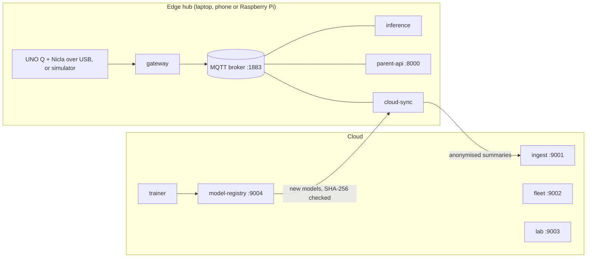

# PodCare — Runbook

Setup, capture, calibration, bench runs, training and running every service. As of 2026-11-14.

All commands run from `software/` in PowerShell with the venv active, unless a line says otherwise. Every script also takes `--help`.

## Overview

For the demo, run `python server.py --mode serial`: one process serves the parent app, the business dashboard and the Product Lab on port 8000. The other modes run the same code split into edge and cloud services.

| Mode | Command | What runs | URLs |
| --- | --- | --- | --- |
| 1. Single process | `python server.py [--mode serial]` | Parent app, business, Product Lab | `http://localhost:8000/`, `/business`, `/lab` |
| 2. Local microservices | `python run_local.py [--mode serial]` | MQTT broker + edge + cloud services, no Docker | Parent `:8000/`, business `:9002/business`, lab `:9003/lab` |
| 3a. Docker | `docker compose -f deploy/docker-compose.edge.yml up --build` and `…cloud.yml` | Same services, Mosquitto + Caddy gateway | Parent `:8000/`; cloud on port 80: `/business`, `/lab`, `/v1/…` |
| 3b. Kubernetes | `kubectl apply -f deploy/k8s/podcare-cloud.yaml` | Cloud services only, trainer as a nightly CronJob | Via Ingress or `kubectl port-forward` |
| Debug | `streamlit run live_app.py` | Single-page live dashboard | Streamlit prints the URL |

Working order: set up → flash boards → capture + calibrate → bench runs → train → validate → run a mode.

Generated files are gitignored (`models.joblib`, `training_data.csv`, `calibration.json`, `captures/`, `bench/plots/`, `bench/examples/`, `cloud_data/`, `edge_data/`). Re-create them with the commands below; never commit them.

## One-time setup (Windows, PowerShell)

```powershell
cd "$env:USERPROFILE\OneDrive\Belgeler\Projects\Github\nappies"
python -m venv .venv                 # skip if .venv already exists
.\.venv\Scripts\Activate.ps1
cd software
pip install -r requirements.txt      # numpy, pandas, scikit-learn, joblib, pyserial, paho-mqtt, matplotlib, psycopg
pip install -r requirements-dev.txt  # optional: streamlit for live_app.py
```

- PowerShell refuses to activate the venv: run `Set-ExecutionPolicy -Scope CurrentUser RemoteSigned` once.
- Arduino IDE 2 with board packages for **Arduino UNO Q** and **Nicla Vision**, plus the libraries each sketch `#include`s. OpenMV IDE only if you use the Nicla camera scripts.
- Docker Desktop and minikube are only needed for mode 3.

## Hardware: wire and flash the boards

The UNO Q's A0 and A1 are **not 5 V tolerant**. Check the gas sensor's output voltage before you connect it.

| Sensor | UNO Q pin | Notes |
| --- | --- | --- |
| Moisture, DFRobot SEN0193 v2 | A0 | 0–3.0 V; lower reading = wetter |
| Gas (MQ-type) | A1 | Must stay ≤ 3.3 V. If it can reach 5 V, add a divider: 10 kΩ top, 18 kΩ to GND gives about 3.2 V |
| DHT11 | D2 | Inside the nappy by default (skin climate) |
| Nicla Vision IMU | Own USB port | Separate board |

| Sketch / script | Board | Purpose |
| --- | --- | --- |
| `hardware/pod_sensors/pod_sensors.ino` | UNO Q | Moisture + gas + DHT11, JSON lines, 12-bit |
| `hardware/nicla_imu/nicla_imu.ino` | Nicla Vision | IMU motion, JSON lines |
| `hardware/leak_detection/leak_detection.ino` | Optional extra board | Outer-leak probe (`leak_detected`); never overwrites inside-nappy moisture |
| `hardware/nicla_vision/motion_detection.py` | Nicla Vision (OpenMV) | Camera motion instead of the IMU; `pod_stream.py` understands it |

1. Measure A1 to GND while the gas sensor sees a strong VOC source (vinegar or an alcohol swab). Above 3.3 V → fit the divider first.
2. Flash `pod_sensors` to the UNO Q and `nicla_imu` to the Nicla in Arduino IDE.
3. Close Serial Monitor (Windows lets only one program hold a COM port), then check both boards:

```powershell
python pod_stream.py --list                    # USB serial ports, Arduino boards marked
python pod_stream.py                           # auto-detect every Arduino board and print merged live rows
python pod_stream.py --port COM3 --port COM4   # or name the ports, any order
```

Boards are auto-detected by Arduino's USB vendor ID 0x2341, so `--port` is only needed if detection fails. Serial runs at 115200 baud.

## Capture and calibration

`capture.py` records both boards merged at one row per second. Type a label and press Enter to switch what you are recording; about 60 s per label is enough.

```powershell
python capture.py                              # auto-detect; or --port COM3 --port COM4, --out file.csv
python calibrate.py captures/*.csv             # writes calibration.json
python calibrate.py ..\data\*.csv              # recordings from hardware/record_sensor.py also work
```

| Label | Set-up |
| --- | --- |
| `dry` | Moisture sensor dry |
| `wet50` | 50% water test |
| `wet100` | Sensor fully wet |
| `gas_base` | Gas sensor in clean air, after warm-up |
| `gas_voc` | Vinegar or alcohol swab near the gas sensor |
| `still` | Nicla lying still |
| `active` | Nicla moved or shaken gently |
| `q` | Quit |

- `calibrate.py` drops the first 5 s after each label switch. Any label you didn't record keeps its placeholder value.
- For `record_sensor.py` files it takes the label from the `experiment` column or the file name (`dry`, `50%`, `50_water`, `100`, `full_water` are recognised).
- DHT11 in the room instead of the nappy: add `--dht room` to `server.py` or `run_local.py`.

## Bench protocol runs

`bench.py` runs a timed protocol on a real nappy. Press **Enter** at the moment you pour or place the proxy, so every row carries a true label. Runs are saved to `bench/`.

```powershell
python bench.py insult   --nappy "Brand A size 3" --placement "under topsheet"
python bench.py insult   --nappy "Brand A size 3" --press            # adds a rewet press test at the end
python bench.py movement --nappy "Brand A size 3" --prewet           # no fluid; flex an already-wet nappy
python bench.py poo      --nappy "Brand A size 3"
python bench.py insult   --simulate --auto --nappy "test"            # dry run without hardware
```

| Protocol | What happens |
| --- | --- |
| `insult` | 2 min dry baseline, then 4 × 30 mL insults 5 min apart; optional `--press` |
| `movement` | No fluid: 1 min still, 3 min moving with the Nicla attached |
| `poo` | 2 min baseline, then the poo proxy next to the gas sensor for 5 min |

Options: `--volume 30` (mL), `--insults 4`, `--wait 300` (s after each insult), `--baseline 120` (s), `--port`, `--out-dir bench`. Use saline (0.9% salt water) at body temperature if you can.

Run the brief's matrix: 2 P&G products × 2 sensor placements. Put the product in `--nappy` and the placement in `--placement`.

- [ ] Product A, placement 1
- [ ] Product A, placement 2
- [ ] Product B, placement 1
- [ ] Product B, placement 2

Send runs to the cloud Product Lab (mode 2 or 3 running):

```powershell
python upload_bench.py bench/*.csv --cloud http://localhost:9001 --key dev-key
```

`--cloud` and `--key` default to the `CLOUD_URL` and `API_KEY` environment variables.

## Training, examples and validation

```powershell
python train.py                                         # 300 synthetic sessions -> models.joblib + models_report.txt
python train.py --sessions 300 --bench "bench/*.csv"    # also learn from real labelled bench runs
python validate.py                                      # all runs in bench/ (examples if no real runs yet)
python validate.py bench/my_run.csv                     # specific runs
python make_examples.py                                 # SIMULATED example runs in bench/examples/ for the Lab
python simulate.py --sessions 5 --out sample.csv        # dump synthetic data to inspect
```

- `train.py` options: `--sessions 300`, `--seed 42`, `--cal calibration.json`, `--out models.joblib`, `--bench "<glob>"`, `--bench-weight 5`. Keep the glob in quotes.
- Sessions are split train/test by session, so test data is never seen in training.
- `validate.py` writes `validation_report.md` and one plot per run in `bench/plots/`: accuracy, detection delay, false alarms (movement runs), wees detected vs insults.
- Simulated examples are labelled as simulated and hidden once real runs exist in `bench/`.

| Model | Type | Last result |
| --- | --- | --- |
| Dry / wet / soiled | Random forest | ~97–99% on synthetic held-out data |
| Still / moving | Small decision tree (can run on-device) | — |
| Full within 60 min | Gradient boosting classifier (main signal) | AUC ~0.88 before full |
| Minutes until full | Gradient boosting regressor | Display only |

## Run mode 1: single process (demo)

```powershell
python server.py                                       # simulator, no hardware
python server.py --mode serial                         # auto-detects the UNO Q + Nicla
python server.py --mode serial --port COM3 --port COM4
```

Options: `--age 0-3m|3-6m|6-12m` (default 3-6m), `--size 1-5` (default 3), `--baby Ava`, `--no-demo-history`, `--http-port 8000`, `--dht nappy|room`.

| URL | App |
| --- | --- |
| `http://localhost:8000/` | Parent app (phone UI + demo controls) |
| `http://localhost:8000/business` | P&G business dashboard |
| `http://localhost:8000/lab` | Product Lab: bench comparison + model validation |

It listens on 0.0.0.0, so a phone on the same Wi-Fi can open `http://<laptop IP>:8000/`.

Demo run with real boards:

1. Pod on a dry nappy: app shows dry.
2. Pour water: "Wee detected, soaking in", then the settled fill %.
3. More pours: fill climbs toward "Change soon" (70%) and "Change now" (85%).
4. VOC source near the gas sensor: soiled, change now.
5. Shake the Nicla, then hold it still: active vs asleep changes the advice.
6. Switch to `/business`, then `/lab` for the P&G story.

Debug dashboard (Streamlit, needs `requirements-dev.txt`):

```powershell
streamlit run live_app.py   # sidebar source: Simulator, Serial (ports "auto" or "COM3, COM4"), or Replay CSV
```

## Run mode 2: microservices, no Docker

```powershell
python run_local.py                                    # simulated pod, edge + cloud
python run_local.py --mode serial --port COM3 --port COM4
python run_local.py --edge-only                        # hub only
python run_local.py --cloud-only                       # cloud only
```

Options: `--mqtt-port 1883`, `--sessions 150` (trainer, first run only), `--summary-s 20` (cloud-sync upload interval), `--dht nappy|room`. Ctrl+C stops everything.

| Side | Service | Port / URL | Job |
| --- | --- | --- | --- |
| Edge | MQTT broker | 1883 | Pure-Python dev broker |
| Edge | `gateway` | — | Serial or simulator → MQTT |
| Edge | `inference` | — | Models, events, day metrics |
| Edge | `parent-api` | `http://localhost:8000/` | Parent app + commands |
| Edge | `cloud-sync` | — | Only cloud link: opt-in anonymised summaries, SQLite spool offline, pulls models with a SHA-256 check |
| Cloud | `ingest` | `http://localhost:9001/v1/aggregate` | Summaries + bench CSV uploads |
| Cloud | `fleet` | `http://localhost:9002/business` | Business dashboard + live roll-up |
| Cloud | `lab` | `http://localhost:9003/lab` | Product Lab |
| Cloud | `model-registry` | `http://localhost:9004/v1/models/latest` | Model versions |
| Cloud | `trainer` | — | Runs once at start-up if no model is published yet |



Worth showing judges: summaries flowing edge → cloud, `upload_bench.py` runs appearing in the Lab, an over-the-air model install, and spooling while the cloud is down (`--edge-only`, then start `--cloud-only`).

## Run mode 3a: Docker Compose

Run from `software/`. The images have not been built yet, so build once on a network that reaches Docker Hub before the demo.

```powershell
# Cloud: model-registry, ingest, fleet, lab, Caddy gateway on :80, :9001, :9004
$env:API_KEY = "change-me"
docker compose -f deploy/docker-compose.cloud.yml up --build -d

# Edge: mosquitto (127.0.0.1:1883), gateway, inference, parent-api (:8000), cloud-sync
docker compose -f deploy/docker-compose.edge.yml up --build -d

docker compose -f deploy/docker-compose.cloud.yml ps
docker compose -f deploy/docker-compose.cloud.yml logs -f
docker compose -f deploy/docker-compose.cloud.yml down
```

Cloud gateway (Caddy, port 80): `/business` → fleet, `/lab` → lab, `/v1/…` → ingest, `/v1/models/…` → model-registry. Swap `:80` in `deploy/Caddyfile` for a domain to get automatic HTTPS.

Real boards with Docker Desktop on Windows: Docker can't pass USB serial into containers. Leave the edge gateway at `MODE=sim` (or remove it) and run the gateway natively:

```powershell
$env:MQTT_HOST = "localhost"; $env:MODE = "serial"
python services/edge/gateway.py      # ports auto-detected
```

On a Linux hub, uncomment `devices:` under `gateway` in the edge compose file instead.

## Run mode 3b: Kubernetes (minikube)

The manifest has an `IMAGE` placeholder and expects a ReadWriteMany volume. For a local test:

```powershell
docker build -t podcare:dev -f deploy/Dockerfile .
minikube start
minikube image load podcare:dev
(Get-Content deploy/k8s/podcare-cloud.yaml) -replace 'image: IMAGE', 'image: podcare:dev' | Set-Content deploy/k8s/podcare-local.yaml
kubectl apply -f deploy/k8s/podcare-local.yaml
kubectl get pods -n podcare -w
kubectl port-forward -n podcare svc/fleet 9002:9002      # then http://localhost:9002/business
kubectl create job -n podcare --from=cronjob/trainer trainer-now   # run the 02:00 trainer now
```

- Use a tag other than `latest` so Kubernetes doesn't try to pull the image from a registry.
- Set the API key in the `podcare-secrets` Secret before applying.
- A PVC stuck in `Pending` means the storage class can't do ReadWriteMany.
- For a real cluster: `docker buildx build -t <registry>/podcare:<tag> --push -f deploy/Dockerfile .` and put that image in place of `IMAGE`.
- Edge hubs are never deployed to Kubernetes; they use the edge compose file.

## Tuning, demo-day order and troubleshooting

Fullness thresholds live in `config.py`. The change rules are coded in `recommend.py` **and** mirrored in `web/parent.html`, so change both.

| Setting | What it controls | Current rule |
| --- | --- | --- |
| `RISE_JUMP` | Surface rise that counts as a new wee | — |
| `SETTLE_S` | Time allowed for a wee to settle | — |
| `FLAT_TOL` | How flat the reading must be to count as settled | — |
| `STUCK_S` | Wee still not soaked in → change now | 10 min |
| `SLOW_ABSORB_X` | Absorption slowdown vs the first wee → change soon | 2.5× |
| `CHANGE_SOON_FILL` | Settled fill → change soon | 70% |
| `MAX_WEAR_MIN` | Wear time while awake → change soon | 4 h |

Tuning loop: edit `config.py` → `python train.py --bench "bench/*.csv"` → `python validate.py` → compare false alarms and detection delay.

Demo-day order:

- [ ] Activate the venv, `cd software`
- [ ] Plug in both boards, close Serial Monitor, `python pod_stream.py`
- [ ] `python calibrate.py captures/*.csv` if the sensors moved
- [ ] `python train.py --bench "bench/*.csv"`
- [ ] `python make_examples.py`
- [ ] `python validate.py`, keep the plots for the deck
- [ ] `python server.py --mode serial`, open `/`, `/business`, `/lab`
- [ ] Backup: `python server.py` (simulator) if a board fails

| Symptom | Likely cause | Fix |
| --- | --- | --- |
| "No Arduino boards found" | Charge-only cable, or the board isn't enumerated | Data cable; `python pod_stream.py --list`; pass `--port` |
| Port busy / access denied | Serial Monitor or another script holds the COM port | Close it; one reader per board |
| Gas stuck at 4095 | Output above 3.3 V | Add the divider; check the pin |
| Extra wee counted when the nappy is pressed | Known gap: rewet looks like a rise | Mention it as a limitation |
| `validate.py`: "No bench runs found" | Nothing in `bench/` | Record a run, or `make_examples.py` |
| Port 8000 / 900x already in use | Another mode still running | Ctrl+C it, or `--http-port` |
| Docker build fails at the venue | Docker Hub blocked | Prebuild images; fall back to mode 2 |
